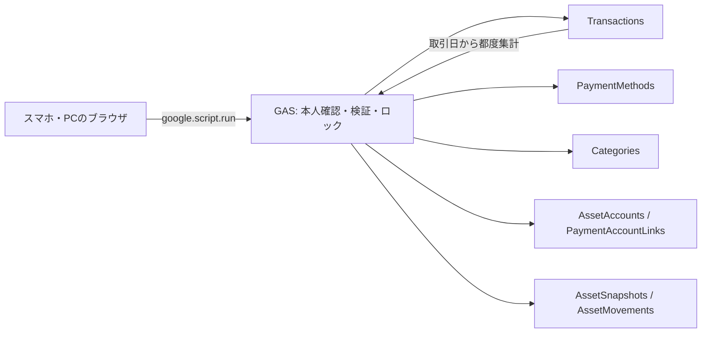

# セミナー会計　早瀬ユウカ監修　家計簿アプリ

個人用の家計簿Webアプリです。Google Apps Script（GAS）のHTML Serviceで画面を配信し、Googleスプレッドシートを唯一の正本保存先にします。[要件定義書 v1.1](docs/requirements.md) に、[資産管理・画面修正の追加仕様](docs/assets.md) を反映しています。

収支登録、履歴の絞り込み・50件ページ分割・編集・論理削除、支払方法とカテゴリの設定、月間集計とグラフに加え、開始残高、資産・負債・純資産、残高への自動反映、金融資産の評価額変更、資産移動・返済、12か月の残高推移を実装しています。純資産は資産合計から負債合計を引いたものです。月間収支差額は残高とは別の値です。銀行等との自動連携・レシート読取・予算管理は含みません。

## 保存後のメッセージカード

新しい収支の保存成功後、以下の条件で「保存しました」とランダムな文言を画面下のメニューの上に表示します。入力を止めるダイアログではなく、約6秒で消えるカードです。×ボタンでも閉じられます。支出は淡いオレンジ、収入は淡い緑です。

| 区分 | 金額 | ランダムに表示する文言 |
| --- | --- | --- |
| 支出 | 10,000円以上 | 先生！使いすぎです！<br>先生、こんなに何に使ったんですか！<br>はあ、私がちゃんと見ていないがばっかりに、、、 |
| 収入 | 30,000円以上 | 先生！よくがんばりましたね！<br>いつもありがとうございます、先生<br>こんなにいっぱい！でも、ちゃんと考えて使うんですよ？ |

区分に対応する3文言から毎回1つを選びます。連続して同じ文言になることもあります。条件未満、保存中、保存失敗、結果不明の段階では表示しません。結果不明の登録を再試行して成功確認できた場合は表示します。履歴の編集・削除、設定保存、資産残高の変更は表示対象外です。

資産管理版を既に利用している場合、今回のカード追加はHTMLの **Index / Styles / JavaScript** の3ファイルを最新版へ差し替え、保存して「新バージョン」でデプロイするだけで反映できます。シート構成とサーバー処理は変更していません。資産管理版への更新も必要な場合は、下の旧版更新手順に従ってください。

## 既に旧版を利用している場合の更新

1. GitHubの **Code → Download ZIP** から最新版を取得します。
2. 既存のGASプロジェクトで `Code.gs`、HTMLの **Index / Styles / JavaScript**、`appsscript.json` の5ファイルを置き換えて保存します。HTMLファイル名は変更していません。
3. 上部の関数プルダウンで **setupDatabase** を選んで実行します。既存の取引・カテゴリ・支払方法を保持し、TransactionsのN列と資産管理用の4シートを追加します。スクリプトプロパティのSPREADSHEET_IDは現在のものを保持してください。
4. **デプロイ → デプロイを管理 → 鉛筆 → 新バージョン → デプロイ** で、公開中のアプリを更新します。本人限定設定は維持します。
5. ウェブアプリを再読み込みし、資産管理の「開始残高」を登録します。既に入力した収支を含む、確認日時点の実際の残高・カード未払額を入力してください。

ファイルの保存だけでは既存の公開バージョンは変わりません。Google上の認可・共有・実保存は本人の操作で確認してください。



## ファイル

| ファイル | 役割 |
| --- | --- |
| `Code.gs` | 初期化、本人確認、収支・残高・移動の保存、履歴、集計 |
| `Index.html` | 入力・集計・資産管理・履歴・設定の5画面 |
| `Styles.html` | スマホ対応スタイル |
| `JavaScript.html` | GAS呼び出し、画面操作、SVGグラフ、再試行 |
| `appsscript.json` | V8、Asia/Tokyo、権限、本人限定公開の既定値 |
| `scripts/dev.cjs` | 一時メモリでGASを模擬するローカル検証サーバー |
| `scripts/gas-runtime.cjs` | ローカル専用のGoogleサービス代替実装 |
| `tests/` | サーバー・Chromiumの自動テスト |
| [TESTING.md](TESTING.md) | 検証結果とGoogle実環境の確認項目 |

## Googleで使い始める

次の作業は、家計簿を使用する本人のGoogleアカウントで行ってください。CodexはGoogleへの認可や公開を行っていません。

1. Google Apps Scriptのホームから、新しいスタンドアロンプロジェクトを作成します。複数の家計簿プロジェクトから同じシートへ書き込まないでください。ロックはプロジェクト単位です。
2. エディタの `Code.gs` をこのリポジトリの同名ファイルに置き換えます。HTMLファイルを3つ追加し、ファイル名を **Index / Styles / JavaScript** にして、それぞれ同名の `.html` の内容をコピーします。
3. プロジェクトの設定から「appsscript.json マニフェスト ファイルをエディタで表示する」を有効にし、このリポジトリの `appsscript.json` をコピーします。タイムゾーンは `Asia/Tokyo`、ランタイムはV8です。
4. 既存スプレッドシートを使う場合だけ、プロジェクトの設定 → スクリプトプロパティに `SPREADSHEET_ID` を登録します。値はスプレッドシートのURLの `/d/` と `/edit` の間のIDです。共有設定を「制限付き」にし、他の編集者がいないことを確認してください。値をコードやGitに記載しないでください。
5. エディタで関数 `setupDatabase` を選択し、実行します。初回はスプレッドシートの作成・読み書きとメールアドレスの取得を認可してください。個人開発アプリの未確認表示が出る場合は、自分が作成したプロジェクトであることを確認して認可します。組織ポリシーが禁止している場合は管理者に確認してください。
6. `SPREADSHEET_ID` が未設定なら、Googleドライブにアプリ名のスプレッドシートを新規作成し、そのIDをスクリプトプロパティに保存します。`OWNER_EMAIL` には実行者本人のメールアドレスを保存します。収支・設定・資産管理の7シートのヘッダーと初期マスタを作成します。初回認可の実行が完了しなかった場合は `setupDatabase` を再実行してください。
7. 作成・指定したスプレッドシートを開き、共有設定の「一般的なアクセス」が **制限付き**、共有相手が本人のみであることを確認します。ウェブに公開しないでください。`setupDatabase` は既存シートの共有権限を変更しません。
8. 「デプロイ」→「新しいデプロイ」→種類「ウェブアプリ」を選択します。**次のユーザーとして実行：自分**、**アクセスできるユーザー：自分のみ** を選び、デプロイします。マニフェストにも本人限定の既定値を入れていますが、画面で最終設定を確認してください。
9. 発行されたウェブアプリURLを本人のアカウントで開き、初回に表示される資産管理画面で開始残高と負債を登録します。ない項目は0円です。[実環境の受け入れ手順](TESTING.md#google実環境で確認する項目) を実施します。動作確認後、スマホでブックマークして利用できます。

本人の判定には `Session.getActiveUser().getEmail()` と `OWNER_EMAIL` の一致を使用します。メールが空になる場合もアクセスを拒否します。「本人のGoogleアカウントでアクセスしてください」と表示されたら、プロジェクト・デプロイの所有者とログインアカウント、本人限定設定を確認してください。第三者アクセスを許可する設定に変えて回避しないでください。

### 更新・初期化の再実行

コードを差し替えたら保存し、「デプロイを管理」→編集→バージョン「新バージョン」で更新します。既存のデプロイを更新すれば同じURLを使用できます。スクリプトプロパティとスプレッドシートは保持してください。

`setupDatabase` を再実行しても取引や変更済みのマスタ・残高履歴は消しません。初期化が中断した場合も同じシートと初期IDを再利用します。`MASTERS_SEEDED` と `ASSET_MASTERS_SEEDED` は初期データ投入の完了フラグです。通常は編集・削除しないでください。

v1.0の `Transactions` のA〜K列を保持し、L・M列にカテゴリ、N列に残高反映先のヘッダーを追加します。旧版のA〜M列もそのまま保持します。標準の7支払方法は初期IDを使って反映先を設定し、既存の取引にもN列だけを補います。独自の支払方法は資産管理タブで反映先を設定し、未設定の過去取引を編集・保存してください。カテゴリ未設定行は「未分類」として集計します。追加列にデータがある場合やヘッダーが異なる場合は初期化を中止します。シートをコピーしてバックアップしてから列構造を確認してください。

### claspを使う場合（任意）

エディタへの手動コピーで利用できます。claspを使用する場合は、本人のPCで公式claspをインストール・認可して、作成済みのスクリプトIDを `.clasp.json` に設定してください。`.claspignore` はGASの5ファイルだけをアップロードする設定です。`.clasp.json` と認証ファイルをGitに追加しないでください。Codex環境へGoogleの秘密値をチャットで送る必要はありません。

## ローカル開発・検証

Node.js 22以上とChromiumを使用します。このクラウド環境ではNode.js 24と `/usr/bin/chromium` を確認済みです。

```sh
cd /workspace/accounting1
npm ci --ignore-scripts
npm run check
npm test
npm run test:browser
npm run dev
```

`npm run dev` はポート3000（`PORT`で変更可）のループバックで検証画面を起動します。実行中だけの一時メモリデータであり、Googleへの接続・保存はしません。画面上部にローカル検証モードの表示があります。再起動するとデータが消えます。本物の家計データを入力する用途には使わないでください。クラウド環境のオンボーディングUIにはこのローカル画面の公開プレビュー機能はありません。

ブラウザテストは `CHROMIUM_PATH`、次にシステムのChromium、最後にPlaywright同梱ブラウザの順で使用します。本人のPCにChromiumがない場合は `npx playwright install chromium` を実行してからテストしてください。OSライブラリが不足する場合はPlaywrightの公式手順に沿って準備してください。テストは各ケースで別の一時サーバーを起動し、終了時に停止します。スクリーンショットはGit対象外の `.local/screenshots/` に保存します。

このクラウドタスクは既に隔離されています。既存のチェックアウトを使用し、明示的な指示なしにGit worktreeを作成しないでください。

## データの取り扱いと実装上の選択

- 本番の保存先はスクリプトプロパティの `SPREADSHEET_ID` のみです。ブラウザの `sessionStorage` は保存結果が不明なリクエストを復元するための一時領域で、取引の正本には使用しません。
- 登録はスクリプトロック内で `request_id` の既存行を確認してから保存します。保存中はボタンを無効にします。結果不明の場合は内容を変更せず、同じリクエストIDで再送します。確認済みの入力エラーでは編集を再開でき、内容が同じ再試行は同じIDを使用します。
- 結果不明のリクエストは同じタブの再読み込み後も復元できます。タブを閉じると一時状態を失う場合があります。ブラウザが一時保存を拒否した場合は警告します。確認が完了するまでタブを閉じないでください。復元できない場合は、再入力前に履歴を確認してください。
- 編集・マスタ変更は更新日時による競合検出を行います。失われた応答への同内容の再送は、保存済み内容を返します。削除は既に削除済みでも成功として扱います。別の内容に更新済みなら上書きせず、読み直しを要求します。
- 削除行・使用停止したマスタは物理削除しません。使用停止項目は過去の編集で同じIDを維持する場合に利用できます。集計キーはカテゴリID、表示名は現行マスタ名です。参照不能なら保存時名称を表示します。
- 金額は `Number.MAX_SAFE_INTEGER` までの正の整数です。集計の合計が整数精度の範囲を超える場合はエラーにします。備考は10,000文字、設定名称は100文字以内です。
- 日付入力は端末標準の年・月・日ピッカーを使用します。独自ダイヤルUIの代替として、端末のアクセシビリティと操作性を優先しました。対応範囲は1900〜9999年です。当日の判定と保存日時は `Asia/Tokyo` です。
- 名前・備考はSheetsのリテラル文字列エスケープで保存し、画面には `textContent` を使用します。HTML文字列として挿入しません。スプレッドシートで数式として扱われないことはGoogle実環境でも確認してください。
- グラフはSVGで描きます。外部ライブラリやCDNへの通信はありません。凡例と金額表でデータを確認できます。
- 初回の開始残高は、既存の収支を含む確認日時点の金額を登録します。以後の収支は反映先ごとに再集計され、二重送信や編集・削除で残高を重複更新しません。現金・銀行・電子マネーの支出は資産を減らし、カード利用は未払額を増やします。
- 金融資産は資産管理タブの「変更」から、その日の評価額を登録します。過去の評価額を保持し、月末時点で集計します。開始前の月は0円と決めつけず「未登録」と表示します。
- カード返済・銀行から現金への引き出し・SUICAやPayPayへのチャージは「資産移動・返済」で登録します。収支に重複計上しません。借入は負債から資産への移動で登録します。これらの明細は資産管理タブで確認・論理削除できます。
- カスタム支払方法を追加したら、資産管理タブで反映先を設定してください。変更は以後の登録に適用し、過去の取引の反映先を維持します。参照名の変更でもIDが一致する限り残高計算は変わりません。
- 集計と履歴はシートの取引行を都度読み込みます。個人用MVPを想定しており、大量データでのGAS実行時間・割当量の負荷試験は未実施です。シートの手動編集や別プロジェクトからの書き込みはアプリのロックと検証の対象外です。

自動テストの合格はGoogle実環境での認可・共有権限・GAS実行の検証を意味しません。検証範囲と未確認事項は [TESTING.md](TESTING.md) を確認してください。
